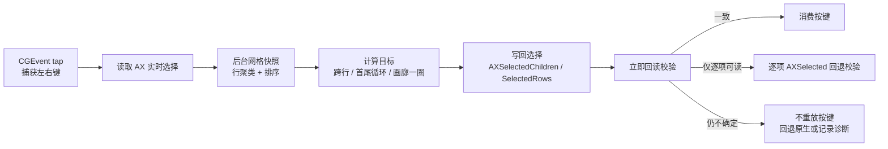

# FinderWrap

Finder 图标视图的左右键换行工具：菜单栏常驻 → 后台读取可见网格 → 按键时实时读取选中项 → 计算跨行目标 → 写回选择并回读校验。支持普通文件夹、搜索/智能文件夹、分组图标、桌面、Quick Look 与多选；文档与画廊首尾循环，列表可切换为左右键切上一项/下一项。

📦 **下载**：<https://github.com/ygnstudio/FinderWrap/releases/latest> · 🍺 **Homebrew**：<https://github.com/ygnstudio/homebrew-ygn>

关注作者：[小红书主页](https://www.xiaohongshu.com/user/profile/66a7e7ae000000001d023641)

## 功能特性

- **图标视图跨行**：行尾按右键进入下一行第一个，行首按左键回到上一行最后一个；整个图标区首尾也会循环，不再卡在行尾。
- **全场景覆盖**：普通 / 搜索 / 智能 / iCloud 文件夹、按种类分组、行被窗口裁切、桌面图标、Quick Look（Finder 前台、焦点在预览窗口时继续驱动底下的图标布局）、多选（以最外侧选中项定位）。
- **画廊到头循环**：缩略图条到两端时循环；左右键全由应用接管（读选择 → 算目标 → 写选择 + 设焦点 + 滚动），不依赖 Finder 自身的键盘光标。
- **列表左右切项**（独立开关，默认关闭）：左/右 = 上一项/下一项；端点按键被吞掉、保持原选择，绝不把右键变成“展开文件夹”。
- **零常驻窗口**：只驻留菜单栏（`LSUIElement`，无 Dock 图标与主窗口）；点图标即可开关、查看权限与状态、复制诊断或退出。
- **只读 + 写回校验**：布局只读；每次写选择后立即回读，失败时逐项 `AXSelected` 兜底，不确定结果不会重放按键。
- **两项权限**：只安装辅助功能与输入监控。1.0.8 起不再需要“自动化 Finder”（Apple Events）。
- **记住开关**：总开关、列表与画廊选项写入偏好，下次启动自动恢复（权限不全时保持关闭）。
- **界面语言**：跟随系统 / 中文 / English，切换后菜单面板立即生效。
- **外观**：跟随系统 / 浅色 / 深色，切换后面板与菜单立即生效。

## 覆盖范围

| 场景 | 行为 |
|---|---|
| 普通 / 搜索 / 智能 / iCloud 文件夹图标视图 | 跨行换行，文档首尾循环；单/多选均可 |
| 按种类分组的图标视图 | 行按 Y 坐标聚类，跨组继续换行 |
| 行被窗口边缘裁切 | 只要边缘行可读到几何就参与换行 |
| 桌面图标 | 支持（桌面表面不是 AXGrid，按焦点 AXGroup 识别，逐项写选择） |
| Quick Look | 支持（继续驱动底下的图标布局，不抢焦点） |
| 画廊视图 | 缩略图条两端循环（可关闭） |
| 列表视图 | 左右键切上一项/下一项（独立开关）；**端点不循环** |
| 分栏、重命名、搜索框等编辑态 | 保持 Finder 原生 |

- 当前版本：**1.0.8（build 11）**，仅 Apple Silicon（arm64），最低 macOS 13。
- Intel 用户请继续使用 1.0.3；macOS 15 / 27 尚未实机验收，见 [兼容性](docs/compatibility.md)。

## 目录结构

```
FinderWrap/
├── Rebuild/                          # 生产实现：Swift Package 核心 + 菜单栏宿主
│   ├── Package.swift                 #   FinderBridge 库与测试目标（macOS 13+）
│   ├── Sources/FinderBridge/
│   │   ├── AX.swift                  #   有界 Accessibility 读取与写入助手
│   │   ├── GridModel.swift           #   网格模型 + 纯函数换行判决（可单测）
│   │   ├── GridReader.swift          #   后台布局抓取、表面识别、诊断
│   │   └── FinderWrapMonitor.swift   #   事件 tap、按键判决、写回校验、列表/画廊接管
│   ├── Host/                         #   SwiftUI 菜单栏宿主
│   │   ├── CandidateApp.swift
│   │   ├── Info.plist                #   版本、LSUIElement、最低系统
│   │   └── entitlements.plist        #   空（不再需要 Apple Events）
│   └── Tests/FinderBridgeTests/      #   15 项 XCTest
├── Resources/Assets.xcassets/        # 应用图标
├── scripts/                          # 构建 / 测试 / 打包 / 签名 / 诊断
│   ├── build.sh / test.sh
│   ├── package.sh / ci-sign-package.sh / archive-ci-build.sh
│   ├── signing-policy.py / check-minimum-system.py
│   ├── install.sh / uninstall.sh
│   └── diagnose-menubar.py / repair-menubar-association.py
├── Tests/                            # Python 签名/系统测试与合成目录
├── docs/                             # 架构 / 兼容性 / 验收 / 安装 / 签名
├── config/signing.json               # 固定证书指纹与 designated requirement
└── .github/workflows/ci.yml          # CI：测试 → arm64 Release → 固定签名打包
```

## 按键处理流程

事件 tap 只做有界 AX 读写，完整布局采集在后台队列完成；选择变化不再作废布局。



## 场景识别与安全边界

- **图标视图**：焦点向上找到 `AXGrid`，或带 `IconView` 标识的 `AXList/AXCollectionList`；结构不符时退化为“任何能读出 ≥2 个图标单元格的滚动区”，兼容 macOS 15/27 的结构差异。
- **桌面**：没有普通图标集合，也没有焦点窗口；取焦点 `AXGroup/AXScrollArea` 中能读到图标项的那一层作为表面，逐项写选择。
- **Quick Look**：Finder 仍在运行、焦点窗口子角色为 Quick Look（大小写不敏感）；取 AX 窗口列表中第一个非 Quick Look 的图标窗口作为被预览布局。
- **画廊**：单行缩略图条走“全接管”逻辑；标识缺失时按“单行 + 可写集合”识别。
- **列表**：焦点为 `AXOutline`（标识含 List，或标识缺失但宽度 > 250，排除侧边栏）；左右键只做原生上一项/下一项。
- **安全**：布局只读；写选择必须回读确认；失败逐项兜底；不重放、不注入原键；不确定时保持原生并记录原因。

## 安装与升级

Homebrew（推荐）：

```sh
brew tap ygnstudio/ygn
brew install --cask ygnstudio/ygn/finderwrap
brew upgrade --cask ygnstudio/ygn/finderwrap   # 升级
brew uninstall --cask ygnstudio/ygn/finderwrap # 卸载
```

或从 [Releases](https://github.com/ygnstudio/FinderWrap/releases/latest) 下载 DMG/ZIP，并用同名 `.sha256` 校验：

```sh
shasum -a 256 -c FinderWrap-1.0.8-b11-fixed-arm64.sha256
```

- 要求 Apple Silicon（arm64）、macOS 13+；1.0.8 不再提供 Universal 包，Intel 用户保留 1.0.3。
- 使用固定自签证书，未做 Apple 公证；首次打开被拦截时，核对来源后到「系统设置 → 隐私与安全性」允许打开。Homebrew 保留系统安全检查。
- 首次打开后授予辅助功能、输入监控，再开启「左右键自动换行」。应用只驻留菜单栏，无 Dock 图标与主窗口。

## 开发与测试

需要 Xcode 命令行工具，不引入第三方运行时依赖。

```sh
bash scripts/test.sh          # Swift XCTest + Python 签名/系统测试
bash scripts/build.sh Release # arm64 Release，输出 build/Products/Release
bash scripts/package.sh --fixed  # 固定证书已配置时生成 DMG/ZIP
```

- Swift 测试覆盖纯逻辑：行聚类、跨行换行、不齐末行、单行循环、文档首尾循环、多选锚点、重复 URL、非法几何；测试不访问 Finder、不发真实按键、不改权限。
- Python 测试覆盖签名策略、最低系统、固定证书规则；CI 另做 shell 语法检查与未签名归档。
- 构建与发布约束见 [验收](docs/testing.md) 与 [签名](docs/signing.md)。

## 兼容性

| macOS | 状态 |
|---|---|
| 26.x | 本机实测通过（26.6.2 / Finder 26.4） |
| 15.x | 历史反馈过“无反应”（旧核心卡在窗口/section 校验）。1.0.8 已移除这些硬校验，增加结构回退与逐项兜底，**尚未实机复验** |
| 27.x | 未实机；使用 SDK 27 构建，结构回退与诊断同样适用，仍需实机确认 |

出现“无反应”时：点菜单栏图标 →「复制诊断信息」回传。诊断包含 macOS/Finder 版本、权限、焦点与窗口角色、网格标识、行/列数量与最近决策，**不含文件名、路径或按键内容**。详见 [兼容性文档](docs/compatibility.md)。

## 已知限制

- 列表首尾不循环：向不可见行写选择会清空选择，端点按键因此被吞掉而非交给 Finder。
- 分栏、重命名、搜索框等编辑态保持原生；Quick Look 需从图标视图打开。
- AX 与 Apple Events 没有跨进程原子事务：不要同时用另一工具通过自动化更改 Finder 选择。
- 屏外目标、无法确认的折叠组会保持原生；预览版不做“所有布局必然支持”的承诺。

## License

[MIT](LICENSE)。应用使用固定自签证书、未公证、无遥测、不联网；权限由用户自行授予。

### 权限与签名

只需辅助功能与输入监控。签名沿用仓库固定自签证书（`config/signing.json` 固定证书指纹与 designated requirement），升级后签名身份不变，系统权限可继续沿用；macOS 升级或系统重置后仍可能要求重新授权。详见 [签名约束](docs/signing.md)。

### 诊断与反馈

菜单栏面板的「复制诊断信息」导出脱敏文本：系统/Finder 版本、权限、焦点元素与窗口角色、grid 的 role/subrole/identifier、是否走结构回退、selectedChildren 支持、行/列数量、最近 captures/decisions 与最后一次采集失败原因。不包含文件名、路径、窗口标题或按键内容。

### 版本与发布流程

1. `main` 推送触发 [CI](.github/workflows/ci.yml)：单元测试 → arm64 Release → 架构与最低系统检查 → 未签名归档 + 固定签名安装包（`FinderWrap-fixed-signature-<sha>`）。
2. 下载固定签名附件，校验 SHA-256 与 `signing-policy.py verify`，生成 `vX.Y.Z` Release（DMG / ZIP / sha256 / signing.json 四个附件）。
3. Homebrew cask 更新 `version`、`sha256` 与 `depends_on arch/macos`。
4. 1.0.8 的固定签名附件来自本次发布提交的 CI 运行（见 [Releases](https://github.com/ygnstudio/FinderWrap/releases)）；macOS 15/27 实机验收仍是独立事项。

### Homebrew 维护

cask 位于 [ygnstudio/homebrew-ygn](https://github.com/ygnstudio/homebrew-ygn) 的 `Casks/finderwrap.rb`。更新版本时同步修改 `version "x.y.z,build"`、DMG 的 `sha256`、URL 与 livecheck 正则；Apple Silicon 之外的机器请保留 1.0.3 的旧 cask 记录，不要用 `--force` 覆盖用户手动安装的应用。
