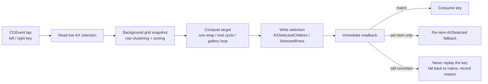

# FinderWrap

Row-wrapping arrow-key navigation for Finder icon views: a menu-bar app reads the visible grid in the background, reads the live selection on each key press, computes the row-boundary target, then writes the selection back and verifies the readback. Works across ordinary folders, search/smart folders, grouped icons, the desktop, Quick Look and multiple selection; document and gallery ends cycle, and list view can map left/right to previous/next item.

📦 **Download**: <https://github.com/ygnstudio/FinderWrap/releases/latest> · 🍺 **Homebrew**: <https://github.com/ygnstudio/homebrew-ygn>

Follow the author: [Xiaohongshu](https://www.xiaohongshu.com/user/profile/66a7e7ae000000001d023641)

## Features

- **Icon-view row wrapping**: Right on the last item of a row goes to the first item of the next row; Left on the first item returns to the last item of the previous row. The document ends cycle too, so arrows never dead-end.
- **Broad coverage**: ordinary / search / smart / iCloud folders, grouped icons, rows clipped by the window edge, desktop icons, Quick Look (Finder stays frontmost while the preview owns focus) and multiple selection (anchored on the outermost selected item).
- **Gallery end cycling**: the thumbnail strip cycles at both ends. Left/right are fully taken over by the app (read selection → compute target → write selection + focus + scroll), independent of Finder's own keyboard cursor.
- **List previous/next** (separate switch, off by default): left/right step one row; the end keys are consumed to keep the current selection, so Right never turns into “expand folder”.
- **No persistent window**: menu-bar only (`LSUIElement`, no Dock icon or main window). Click the status item for the switch, permission state, view options, diagnostics and quit.
- **Read-only layout + verified writes**: layout reads never mutate Finder; every selection write is verified by a readback, with a per-item `AXSelected` fallback. Keys are never replayed or injected.
- **Two permissions**: Accessibility and Input Monitoring only. Apple Events automation is no longer needed as of 1.0.7.
- **Settings remembered**: the main switch and view options persist, so the app restores itself on next launch (it stays off when permissions are missing).
- **Display language**: System / Chinese / English, applied to the menu panel immediately.
- **Appearance**: System / Light / Dark, applied to the panel and menus immediately.

## Coverage

| Scenario | Behaviour |
|---|---|
| Ordinary / search / smart / iCloud icon views | Row wrap and document-end cycling; single and multiple selection |
| Grouped icon view | Rows clustered by Y coordinate; wrapping continues across groups |
| Rows clipped by the window edge | Participates as long as the edge row exposes geometry |
| Desktop icons | Supported (the desktop surface is not an AXGrid; identified via the focused AXGroup, selected per item) |
| Quick Look | Supported (keeps driving the grid underneath, does not steal focus) |
| Gallery view | Thumbnail strip cycles at both ends (can be disabled) |
| List view | Left/right previous/next item (separate switch); **endpoints do not cycle** |
| Column view, rename, search fields | Stay native |

- Current version: **1.0.7 (build 10)**, Apple Silicon (arm64) only, macOS 13+.
- Intel users stay on 1.0.3. macOS 15 / 27 are not verified on real hardware yet; see [compatibility](docs/compatibility.md).

## Repository layout

```
FinderWrap/
├── Rebuild/                          # Production implementation: Swift Package core + host
│   ├── Package.swift                 #   FinderBridge library and test target (macOS 13+)
│   ├── Sources/FinderBridge/
│   │   ├── AX.swift                  #   Bounded Accessibility reads and writes
│   │   ├── GridModel.swift           #   Grid model + pure wrap decision (unit tested)
│   │   ├── GridReader.swift          #   Background capture, surface detection, diagnostics
│   │   └── FinderWrapMonitor.swift   #   Event tap, key decision, readback, list/gallery takeover
│   ├── Host/                         #   SwiftUI menu-bar host
│   │   ├── CandidateApp.swift
│   │   ├── Info.plist                #   Version, LSUIElement, minimum system
│   │   └── entitlements.plist        #   Empty (no Apple Events entitlement)
│   └── Tests/FinderBridgeTests/      #   15 XCTest cases
├── Resources/Assets.xcassets/        # App icon
├── scripts/                          # Build / test / package / signing / diagnostics
│   ├── build.sh / test.sh
│   ├── package.sh / ci-sign-package.sh / archive-ci-build.sh
│   ├── signing-policy.py / check-minimum-system.py
│   ├── install.sh / uninstall.sh
│   └── diagnose-menubar.py / repair-menubar-association.py
├── Tests/                            # Python signing/system tests and fixtures
├── docs/                             # Architecture / compatibility / testing / install / signing
├── config/signing.json               # Pinned certificate fingerprint and designated requirement
└── .github/workflows/ci.yml          # CI: tests → arm64 Release → fixed-signature package
```

## Key handling flow

The event tap performs only bounded AX work; full layout capture runs on a background queue and selection changes never invalidate the layout.



## Surface detection and safety boundaries

- **Icon views**: walk up from focus to `AXGrid`, or `AXList/AXCollectionList` with the `IconView` identifier; if the structure differs, fall back to “any scroll area that exposes at least two icon cells” so macOS 15/27 structure changes still work.
- **Desktop**: no ordinary icon collection and no focused window; use the focused `AXGroup/AXScrollArea` layer that yields icon items and select per item.
- **Quick Look**: Finder stays running; the focused window subrole matches Quick Look case-insensitively. The first non-Quick-Look icon window in AX window order is the previewed layout.
- **Gallery**: single-row thumbnail strips use the full-takeover path; without an identifier, a single row of writable cells is treated as a gallery.
- **List**: the focused element is an `AXOutline` (identifier containing List, or no identifier with width > 250, excluding the sidebar); left/right only steps the native previous/next row.
- **Safety**: layout is read-only; every selection write is read back; failures fall back per item; keys are never replayed or injected; uncertain results keep native behaviour and record a reason.

## Install and upgrade

Homebrew (recommended):

```sh
brew tap ygnstudio/ygn
brew install --cask ygnstudio/ygn/finderwrap
brew upgrade --cask ygnstudio/ygn/finderwrap   # upgrade
brew uninstall --cask ygnstudio/ygn/finderwrap # uninstall
```

Or download the DMG/ZIP from [Releases](https://github.com/ygnstudio/FinderWrap/releases/latest) and verify it with the matching `.sha256`:

```sh
shasum -a 256 -c FinderWrap-1.0.7-b10-fixed-arm64.sha256
```

- Requires Apple Silicon (arm64), macOS 13+. 1.0.7 no longer ships a universal build; Intel users stay on 1.0.3.
- Signed with the project's fixed self-signed certificate, not notarized. If the first launch is blocked, verify the download source, then allow it under System Settings → Privacy & Security. Homebrew keeps the system security checks.
- After the first launch, grant Accessibility and Input Monitoring, then enable “左右键自动换行”. The app is menu-bar only: no Dock icon, no main window.

## Development and tests

Xcode command-line tools are required; there are no third-party runtime dependencies.

```sh
bash scripts/test.sh            # Swift XCTest + Python signing/system tests
bash scripts/build.sh Release   # arm64 Release into build/Products/Release
bash scripts/package.sh --fixed # DMG/ZIP when the fixed certificate is configured
```

- Swift tests cover pure logic: row clustering, row wrapping, ragged last row, single-row cycling, document-end cycling, multi-selection anchoring, duplicate URLs and invalid geometry. Tests never touch Finder, send real keys, or change permissions.
- Python tests cover signing policy, minimum system and fixed-certificate rules; CI additionally checks shell syntax and the unsigned archive.
- See [testing](docs/testing.md) and [signing](docs/signing.md) for the build and release constraints.

## Compatibility

| macOS | Status |
|---|---|
| 26.x | Verified locally (26.6.2 / Finder 26.4) |
| 15.x | Historical “no response” reports (the old core stopped at window/section guards). 1.0.7 removes those hard guards and adds structural and per-item fallbacks, **not yet re-verified on real hardware** |
| 27.x | Not tested on real hardware; built with SDK 27, the same fallbacks and diagnostics apply, still needs verification |

On “no response”: click the menu-bar item → “复制诊断信息” (Copy diagnostics) and send the text back. Diagnostics include the macOS/Finder version, permissions, focused element and window roles, grid identifiers, row/cell counts and recent decisions; **no filenames, paths or key contents**. See [compatibility](docs/compatibility.md).

## Known limitations

- List endpoints do not cycle: writing an off-screen row clears the selection, so end keys are consumed instead of being handed to Finder.
- Column view, rename and search fields stay native; Quick Look must be opened from an icon view.
- AX and Apple Events have no cross-process atomic transaction: do not change the Finder selection through another automation tool at the same time.
- Off-screen targets and unconfirmed collapsed groups stay native; the preview release does not promise that every layout is supported.

## License

[MIT](LICENSE). The app uses a fixed self-signed certificate, is not notarized, has no telemetry and no networking; permissions are granted by the user.

### Permissions and signing

Accessibility and Input Monitoring only. Signing keeps the project's fixed self-signed certificate (`config/signing.json` pins the fingerprint and designated requirement); the identity is stable across upgrades so system permissions can carry over, though OS upgrades or a system reset can still require re-approval. See [signing](docs/signing.md).

### Diagnostics and feedback

“复制诊断信息” copies a redacted report: system/Finder version, permissions, focused element and window roles, the grid role/subrole/identifier, whether the structural fallback was used, selected-children support, row/cell counts, recent captures/decisions and the last capture failure. It never includes filenames, paths, window titles or key contents.

### Versioning and release flow

1. A push to `main` runs [CI](.github/workflows/ci.yml): unit tests → arm64 Release → architecture and minimum-system checks → unsigned archive + fixed-signature package (`FinderWrap-fixed-signature-<sha>`).
2. Download the fixed-signature attachment, verify SHA-256 and `signing-policy.py verify`, then publish a `vX.Y.Z` release with DMG / ZIP / sha256 / signing.json.
3. Update the Homebrew cask `version`, `sha256` and `depends_on arch/macos`.
4. The 1.0.7 fixed-signature attachment comes from the CI run for this release commit (see [Releases](https://github.com/ygnstudio/FinderWrap/releases)); macOS 15/27 hardware verification remains a separate item.

### Homebrew maintenance

The cask lives in [ygnstudio/homebrew-ygn](https://github.com/ygnstudio/homebrew-ygn) at `Casks/finderwrap.rb`. When releasing, update `version "x.y.z,build"`, the DMG `sha256`, the URL and the livecheck regex; machines that are not Apple Silicon must keep the old 1.0.3 cask record, and never use `--force` to overwrite a user's manual installation.
